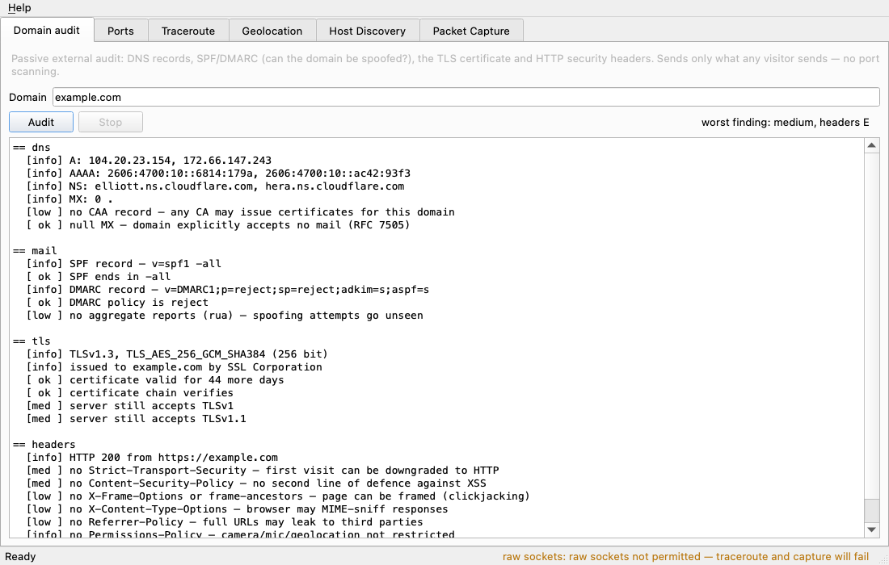
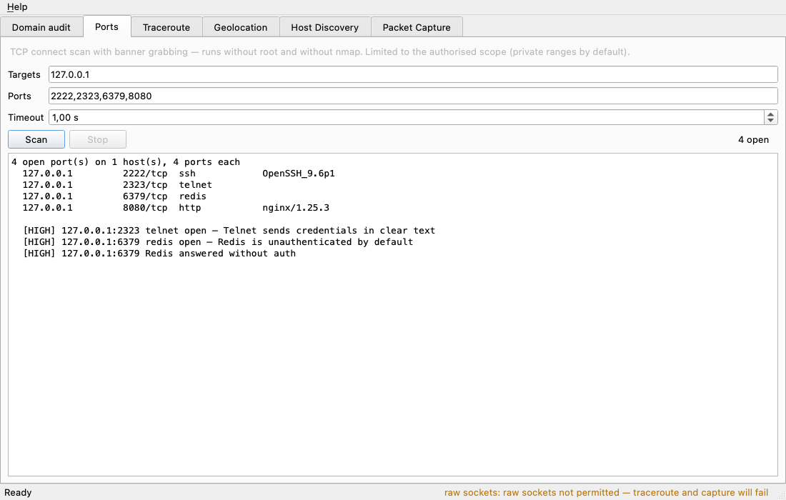

<h1 align="center">NetworkIntelligence</h1>

<p align="center">
  Инструмент для первичной разведки и аудита сети: одной командой проверяет домен<br>
  (DNS, SPF/DMARC, TLS-сертификат, заголовки безопасности), сканирует порты, трассирует маршрут и ловит пакеты.
</p>



Есть консольная утилита `netintel` и Qt-приложение, оба работают на одном ядре. Проверки, сканер портов, DNS-клиент и разбор баннеров написаны на стандартной библиотеке Python, без nmap и сторонних сканеров. Для DNS свой парсер протокола: ни dnspython, ни `dig` не используются. Root не нужен ни для чего, кроме трассировки и захвата пакетов.

## Что умеет

**Аудит домена.** `netintel audit example.com` смотрит на домен так, как его видит любой посетитель, и выдаёт список находок с уровнем риска:

- DNS: A/AAAA/NS/MX/CAA, нет ли CAA, один ли NS-сервер;
- почта: можно ли подделать письмо от имени домена. Проверяется SPF (`+all`/`~all`, лимит в 10 DNS-запросов с учётом вложенных `include`, устаревший `ptr`) и DMARC (`p=none`, `pct`, наличие отчётов `rua`);
- TLS: срок действия сертификата, совпадение имени (с правильной обработкой wildcard), цепочка, самоподписанность, слабые шифры, принимает ли сервер TLS 1.0/1.1;
- HTTP-заголовки: HSTS, CSP (ищет `'unsafe-inline'` именно в `script-src`, без учёта стилей), защита от clickjacking, `nosniff`, Referrer-Policy, утечка версий в `Server`/`X-Powered-By`, флаги cookie. В конце выставляется оценка от A до F.

Портов эта команда не касается, поэтому её можно запускать против любого домена.

**Сканер портов.** TCP connect, 200 потоков, захват баннеров. Сервис определяется по ответу, а не по номеру порта: Telnet на 2323 будет опознан как Telnet. Опасные сервисы (Telnet, Redis без пароля, Docker API, Elasticsearch, MongoDB, SMB, RDP) сразу помечаются находками.



**Остальное.** Трассировка с задержкой по каждому хопу и геолокацией, геолокация IP через ip-api.com, поиск живых хостов в подсети (через nmap, если он установлен, иначе встроенным TCP-перебором), захват пакетов с фильтрами, которые компилируются в BPF.

У каждой команды есть флаг `--json`, так что вывод можно передавать в `jq` или в отчёт.

## Как запустить

Нужен Python 3.11+.

```bash
git clone https://github.com/vldvr/Network_Intelligence && cd Network_Intelligence
python3 -m venv .venv && source .venv/bin/activate
pip install -e ".[all]"
```

Консоль:

```bash
netintel audit example.com              # полный пассивный аудит домена
netintel mail example.com               # только SPF и DMARC
netintel tls example.com                # сертификат и протоколы
netintel headers https://example.com    # заголовки, оценка A–F
netintel dns example.com MX TXT CAA     # DNS-запросы встроенным клиентом
netintel ports 192.168.1.10 -p top      # порты: 22,80,8000-8100 | top | all
netintel discover 192.168.1.0/24        # живые хосты в подсети
netintel geo 1.1.1.1                    # геолокация IP
```

Приложение: `netintel-gui` (или `python main.py`).

Пример на настоящем домене с намеренно просроченным сертификатом:

```console
$ netintel tls expired.badssl.com
expired.badssl.com:443  SAN: *.badssl.com, badssl.com
  [info] TLSv1.2, ECDHE-RSA-AES128-GCM-SHA256 (128 bit)
  [info] issued to *.badssl.com by COMODO CA Limited
  [HIGH] certificate has expired — 2015-04-12
  [HIGH] certificate chain does not verify — certificate has expired
```

Трассировке и захвату пакетов нужны raw-сокеты. В Linux достаточно один раз выдать capability интерпретатору (`sudo setcap cap_net_raw,cap_net_admin+eip "$(readlink -f "$(which python3)")"`), на macOS — поставить ChmodBPF из установщика Wireshark. Всё остальное работает от обычного пользователя.

### Разрешённая зона

Активное сканирование (`ports`, `discover`) по умолчанию разрешено только в частных сетях: 10/8, 172.16/12, 192.168/16, loopback. Чтобы сканировать что-то ещё, область нужно указать явно: флагом `--authorized-scope 203.0.113.0/24` или файлом `netintel-scope.json` (шаблон лежит в [`netintel-scope.json.example`](netintel-scope.json.example)), где заодно записано основание. Проверка срабатывает до отправки первого пакета. Сканировать чужие сети без разрешения нельзя.

## Как устроено

```
              cli/  ─┐
                     ├──▶  core/   (логика, без сети и без Qt)  ──▶  ports.py (интерфейсы)
               ui/  ─┘                                                    ▲
                                                                          │
                                       adapters/  (сокеты, ssl, scapy, nmap, HTTP)
```

| Модуль | Что внутри |
|---|---|
| `core/dnswire.py` | кодирование запросов и разбор ответов DNS по RFC 1035, сжатие имён с защитой от зацикливания |
| `core/mailsec.py` | разбор SPF и DMARC, подсчёт DNS-запросов SPF |
| `core/tlsaudit.py` | правила оценки TLS: сроки, имя, протоколы, шифры |
| `core/headers.py` | аудит заголовков, разбор CSP, оценка |
| `core/portscan.py` | разбор списков портов, распознавание баннеров, рискованные сервисы |
| `core/audit.py` | сборка всех проверок в один отчёт |
| `core/traceroute.py`, `discovery.py`, `capture.py`, `geoip.py` | трассировка, поиск хостов, захват, геолокация |
| `core/scope.py` | разрешённая зона сканирования |
| `adapters/netprobes.py` | UDP/TCP DNS-клиент, TLS-рукопожатие, HTTP-запрос, сканер портов |
| `cli/`, `ui/` | консоль и Qt-интерфейс |

В `core` нет ни сетевого кода, ни Qt: на вход приходят наблюдения (ответ DNS, параметры TLS-сессии, заголовки, баннеры), на выходе получается список находок. Поэтому все правила проверяются тестами без сети. Тест `tests/test_layering.py` ломает сборку, если `core` начнёт импортировать Qt, scapy, nmap или requests.

DNS-клиент сначала отправляет запрос по UDP. Если ответ обрезан или UDP заблокирован, он переходит на TCP (RFC 7766) и дальше работает только по TCP. Ответ с чужим ID отбрасывается.

## Разработка

```bash
pip install -e ".[dev,all]"
pytest              # 300+ тестов, пара секунд, без интернета и root
ruff check .
```

## Лицензия

MIT
